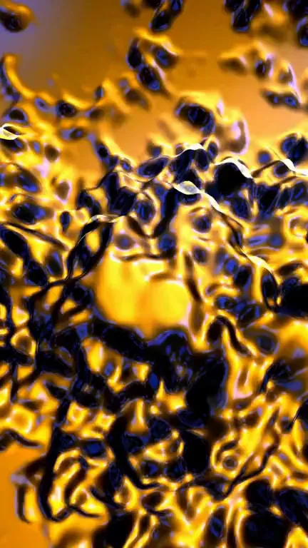
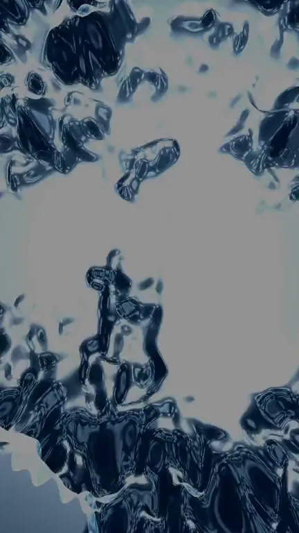
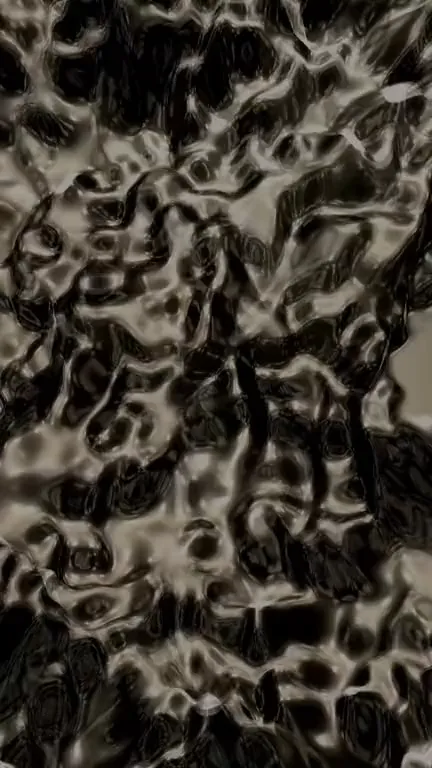
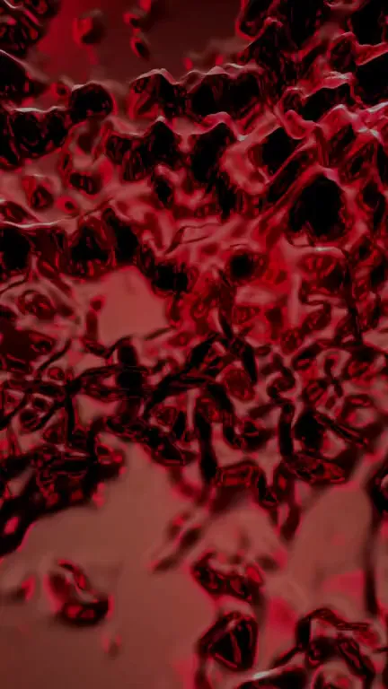

# PRIMAL by Roberto Bosco × Logout

Four generative materials made in Max/Jitter. I presented the project to Logout, who chose it as the artwork for **Logout Summer Sessions 2026**, a series of four nights in Salerno.

| Solar | Air | Earth | Cosmic |
|---|---|---|---|
|  |  |  |  |

## How it works

Every material starts from noise. `jit.gl.bfg` generates a noise texture that moves the surface of a 3D grid (`jit.gl.gridshape`), and `jit.gl.material` decides how the light falls on it. The light and the camera stay the same for all four: only the noise and the colours change.

A short chain of effects finishes the image: ambient occlusion, depth of field and tonemapping (`jit.gl.pass`), then colour correction (`jit.fx.brcosa`) and a fine grain (`jit.fx.grain`).

## Requirements

- **Max 9** (made with Max 9.0.9)
- **[av-toolbox](https://github.com/tmhglnd/av-toolbox)** by Timo Hoogland, used for the timed recording. Put it in `Documents/Max 9/Packages` and restart Max.

Everything else (Jitter, `jit.fx`, Vizzie) comes with Max.

## How to use it

1. Open `primal_by_roberto_bosco_x_logout.maxpat`. It opens in presentation mode.
2. Turn the render on with **ON/OFF**.
3. Pick a material from the preset:
   - **1** Solar
   - **2** Air
   - **3** Earth
   - **4** Cosmic
   - **5** an extra material, not used for the nights
4. Use **Start** to run the animation and record it. The output is 1080 × 1920.

## Credits

Patch and materials by **Roberto Bosco** – [roberto-bosco.com](https://www.roberto-bosco.com/media-lab/#primal)
Made for Logout Summer Sessions 2026, Salerno.

## License

[MIT](LICENSE). The av-toolbox package is not included and keeps its own license (GPL-3.0).
